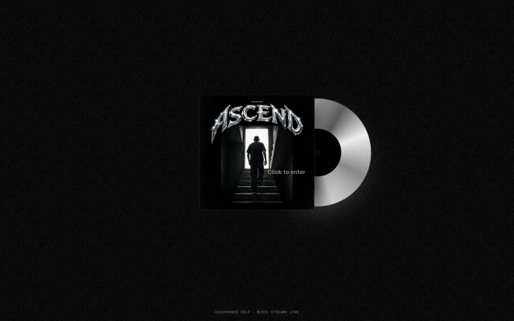
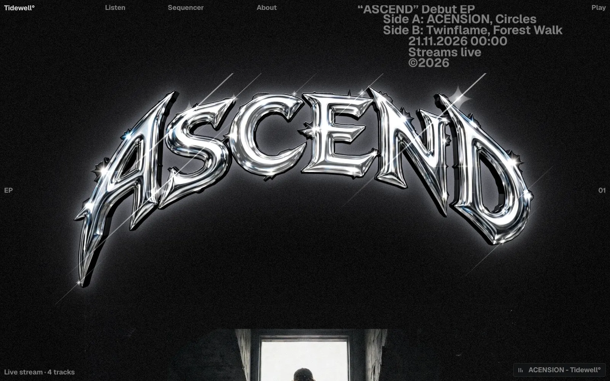
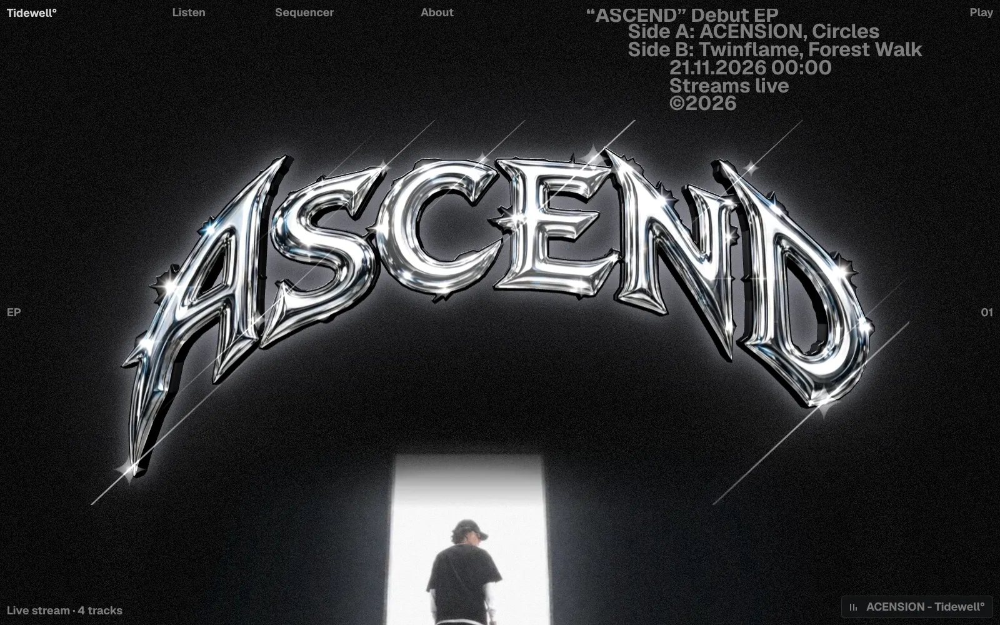
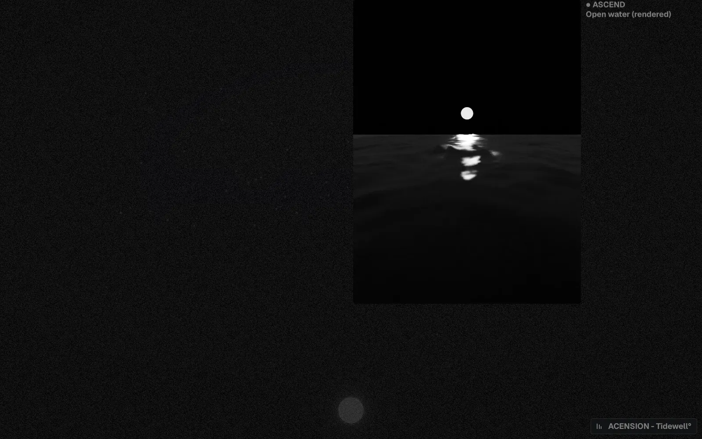
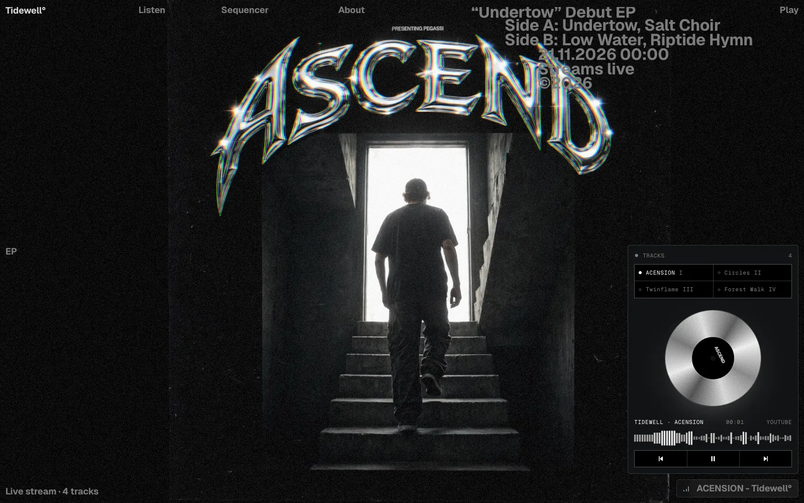
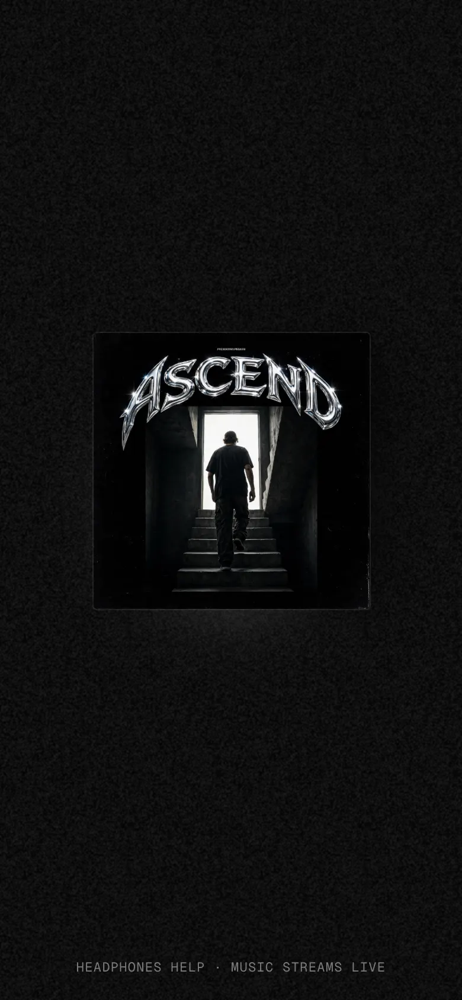
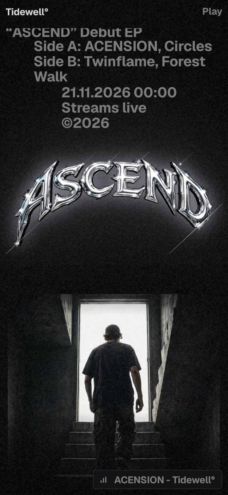
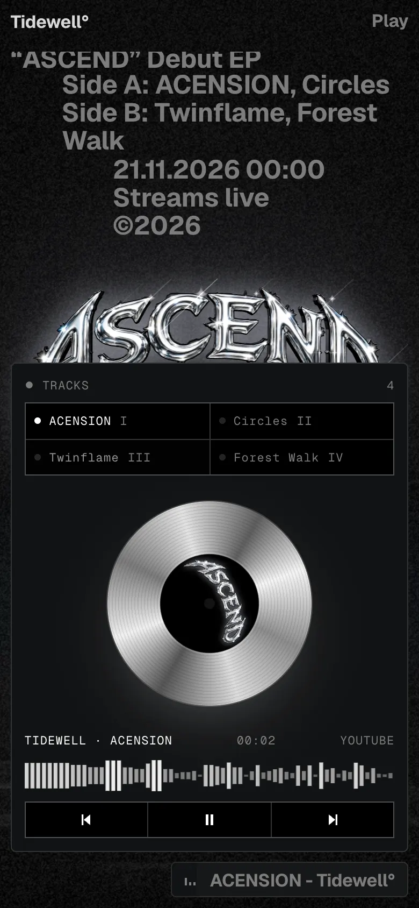
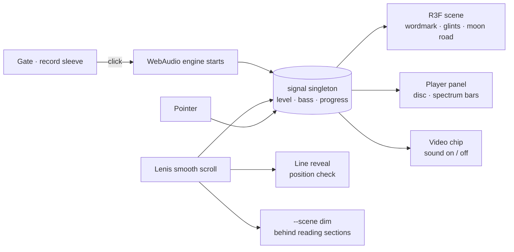

<div align="center">



<br />
<br />

# A S C E N D

**A concept EP release site for a fictional artist, Tidewell.**<br />
Black, silver, a moon on the water, and four tracks your browser writes live.

<br />

**[▶ Visit the live site](https://undertow-sooty.vercel.app)**

<br />


</div>

<br />

<table>
  <tr>
    <td width="50%"></td>
    <td width="50%"></td>
  </tr>
  <tr>
    <td><sub><b>01 · Surface</b>: the chrome wordmark arches over the moon. Glints twinkle and swell with the music.</sub></td>
    <td><sub><b>02 · Sleeve notes</b>: masked lines rise into place, with the first line indented by grid columns.</sub></td>
  </tr>
  <tr>
    <td></td>
    <td></td>
  </tr>
  <tr>
    <td><sub><b>03 · Film</b>: a lazy video panel. A cursor chip follows the pointer, and clicking toggles the sound.</sub></td>
    <td><sub><b>04 · Player</b>: tracks, a spinning silver disc, live spectrum bars and transport.</sub></td>
  </tr>
</table>

<p align="center">
  
  &nbsp;
  
  &nbsp;
  
</p>

---

## ◐ The idea

A release site for an EP that doesn't exist, by an artist who doesn't exist. Nothing is streamed, there are no audio files, and every note is synthesised in the browser the moment you press play.

The site is the record:

1. **You hold the sleeve.** The silver CD slides out as you reach for it.
2. **You enter.** You land on the surface of a night sea.
3. **You scroll.** The camera sinks under the water, and the sleeve notes surface line by line.

## ◑ How a visit flows



Everything that moves every frame reads one plain object (`src/lib/signal.ts`). React state is only for things a person can see change, such as which track is playing.

## ◒ Anatomy

| Piece | File | How it's made |
|---|---|---|
| **Gate: sleeve and CD** | `components/ui.tsx` · `Cover.tsx` | The cover is our Blender still plus an SVG wordmark on a `textPath` arc, filled with a chrome gradient and a soft `feGaussianBlur` glow. Four-point glints twinkle in CSS. The CD sits behind the sleeve at 16%, slides to 30% on hover and 62% on click (1 s, `cubic-bezier(.2,.7,.2,1)`), spins faster, and then the curtain fades over 700 ms. Page scroll is locked until you enter. |
| **Arched chrome wordmark** | `components/Scene.tsx` | `TextGeometry` is bent on the CPU with `x' = (R+y)·sinθ`, `y' = (R+y)·cosθ − R`, where `θ = x/R`. Physical material: metalness 1, roughness .12, clearcoat. It's lit by a `<Lightformer>` environment, with no HDR download. |
| **Moon and its light path** | `Scene.tsx` | An unlit disc on the horizon, plus a flat additive plane carrying a baked falloff of broken horizontal glitter. A seeded PRNG keeps the pattern identical on every visit, and the path pulses with the music. |
| **The descent** | `Scene.tsx` · `ui.tsx` | Scroll progress over 1.6 viewports drives the camera from above the water to below it. The background and fog cross-fade, and the surface underside is drawn only once you're submerged. After that the canvas dims to 14% so the reading sections stay crisp. |
| **Generative EP** | `lib/audio.ts` | A WebAudio lookahead scheduler (25 ms tick, 120 ms horizon) runs 16th-note steps: kick, noise hats, a bass on scale degrees, detuned saw pads and random plucks. Each track has its own BPM, root, scale and waveform. An analyser feeds `level` and `bass`. |
| **Player panel** | `ui.tsx` | A tracks grid, plus a silver disc whose sheen stays still (like light on a real CD) while the label spins. The spectrum is drawn to a canvas with low bins spread on a curve, alongside elapsed time, BPM and transport. Esc closes it and returns focus. |
| **Line reveal** | `components/Lines.tsx` | Words are measured into lines after fonts load. Each line sits in a clip mask and rises from 105% over 1.75 s with expo-out, 0.1 s apart. It triggers by position check, so anchor jumps still reveal. It re-splits on resize. Without JS or with reduced motion the text is plain. |
| **Video panels** | `components/MediaPanel.tsx` | A still sits under a muted loop. The `src` is set only when the panel is near the viewport, it plays only while visible, and the still fades on the first painted frame (`requestVideoFrameCallback`). A blend-mode chip trails the cursor with a lagged tilt. |
| **Sleeve-note layout** | `app/page.tsx` | Full-width display paragraphs with the first line indented 5 columns (4 on mobile), and the marker sitting in the indent on a shared grid row. |

## ◓ Making the footage

Both video loops are ours, rendered headless in Blender and graded with ffmpeg. Nothing is stock.

```bash
# moon over open water (3:4) and a low, closer variant (487:754)
"/Applications/Blender.app/Contents/MacOS/Blender" --background --python art/moon_sea.py -- art/_frames
"/Applications/Blender.app/Contents/MacOS/Blender" --background --python art/moon_sea.py -- art/_frames2 close
```

- **Scene:** an Ocean modifier with its time keyframed linearly, a glossy black water material, a low sun behind the moon to draw the glitter road, and an emissive moon disc.
- **Grade:** grayscale; crush only the sky above the horizon (`geq`); lift the ripples with `curves`; add light temporal grain.
- **Loop:** render 6 s, then `xfade` the last second into the first to get a seamless 5 s loop of about 150 KB.

## ◔ Design tokens

| | |
|---|---|
| **Palette** | `#000000` ink · `#ffffff` text · `#7d7d7d` mute · `rgb(255 255 255 / .14)` hairlines · chrome gradients only on the wordmark and disc |
| **Type** | Geist 600/700 for display, Geist Mono for the 11px uppercase micro labels |
| **Grid** | 12 columns, 1.25rem gaps, 16–24px gutters |
| **Ground** | A 6px dot grid over black; film grain on the gate |
| **Motion** | Lenis `lerp .09` · lines 1.75 s expo-out / 0.1 s stagger · CD 1 s · curtain 700 ms · chip lerp .18 |

## ◕ Care

- **Reduced motion:** no line split, no CD travel, no autoplaying video, and a gentler scene.
- **No WebGL:** a static radial-gradient wordmark stands in for the canvas.
- **Keyboard:** focus rings throughout, the gate tile autofocuses, Esc closes the player and returns focus, and every control has a name.
- **Performance:**
  - The WebGL support check runs once.
  - Video `preload="none"`, loaded only when near.
  - The canvas DPR is capped at 1.75, and bloom is toned down on narrow screens.

## ● Run it

```bash
npm install
npm run dev        # http://localhost:3000
npm run build && npm start
```

```
src/
  app/            layout, page (section order), globals.css (tokens, disc, gate, line reveal)
  components/     Scene · Cover · Lines · MediaPanel · ui (gate, player, tracklist, smooth scroll)
  lib/            audio.ts (generative engine) · signal.ts (per-frame values)
art/              moon_sea.py (Blender footage)
public/media/     rendered loops and stills
public/fonts/     wordmark typeface + licence
```

---

<sub>

**Originality.** The interaction patterns of this *kind* of site were studied from [ascension.pegassi.be](https://ascension.pegassi.be): a gate cover, line reveals, video panels and a player. We studied them as behaviour only; no code, music, imagery, copy or identity was reused. Tidewell, Undertow, its dates and its venues are fictional, and every asset here was made for this project. The wordmark uses the MgOpen Moderna-derived typeface; its licence is in `public/fonts/`.

</sub>
